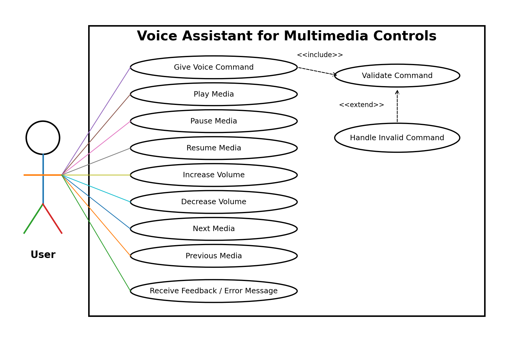
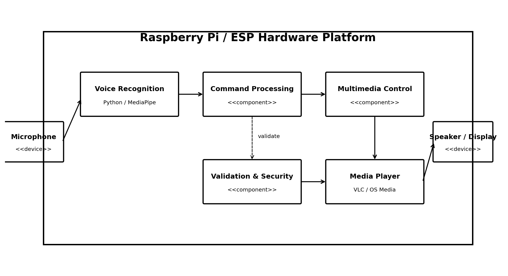
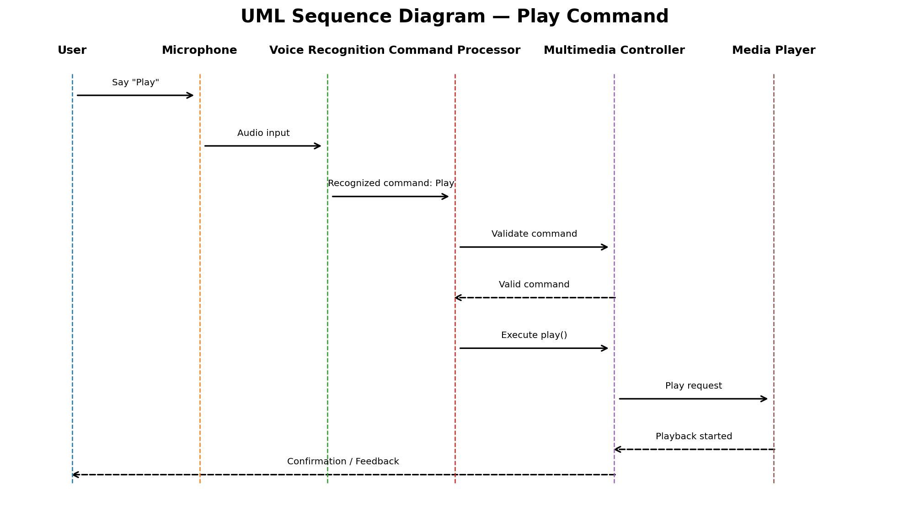
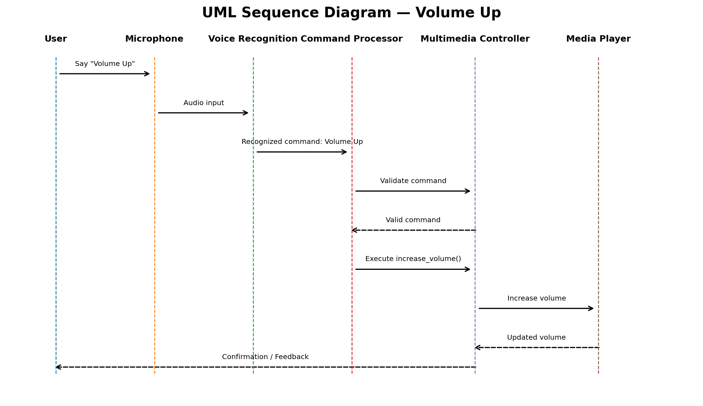

# Architecture and UML Diagrams — Team H6

These are the **original diagrams extracted from** [`MINI PROJECT.pdf`](../../MINI%20PROJECT.pdf), not redesigned replacements. They have been separated into PNG files so GitHub can display them inline.

## Use-case diagram
*Source: SRS, PDF page 10.*

## System component / architecture diagram
*Source: Software Architecture and Design Specification (SAD), PDF page 15.*

## Sequence diagram 1 — Play
*Source: SAD, PDF page 17.*

## Sequence diagram 2 — Volume Up
*Source: SAD, PDF page 18.*

## Implemented system notes

The diagrams reflect the original design document. In the current Raspberry Pi verification setup, the Android phone with IP Webcam supplies the voice stream and the `InMemoryPlayer` backend **simulates** multimedia state changes; it does not produce audible playback. This implementation detail is described in the [project README](../../README.md) and [Sprint 2 verification notes](../sprint-2-implementation.md).

The system's safety boundary remains: **voice input → recognition → allow-list validation → multimedia controller → player backend**. Unsupported commands must be rejected before an operation is dispatched.
